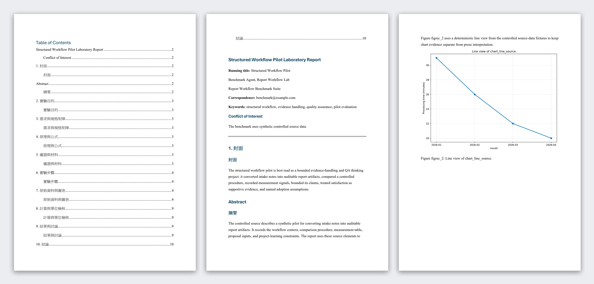

# Report Workflow

<!--
MCP Registry ownership marker. The registry verifies a PyPI package by looking
for this line in the published README, so it has to ship in the release, not
just sit in the repository. Both casings are present because the namespace is
derived from a GitHub login and only one of them will match.
mcp-name: io.github.0smallcat0/report-workflow
mcp-name: io.github.0Smallcat0/report-workflow
-->

[](https://github.com/0Smallcat0/report-workflow/actions/workflows/ci.yml)


[](LICENSE)

**繁體中文說明 → [README.zh-TW.md](README.zh-TW.md)**

**Give your AI the files you already have and one sentence about what you need.
Get back a Word document you can hand in.**

If the AI writes a number that is not in your files, that number does not reach
the document. Same for a quote it reworded, or a paper it cited that does not
exist. It gets stopped, and you are told which sentence and why.

**You bring**: a spreadsheet of measurements, a Word handout, a page of notes —
whatever you already have. Plus one sentence, like "write a lab report on this".

**You get**: a `.docx` with a table of contents, page numbers, real Word tables,
and charts drawn from your own numbers. It can follow your department's or your
company's template. Chinese or English.

Two lines to install. No API key. Nothing to configure.

## Look before you install

Here is a document it made, and the note that comes with it. Both are in this
repository, so you can see the output before you run anything:

- **[`examples/output/report.docx`](examples/output/report.docx)** — the file
  you would hand in: contents page, page numbers, a real Word table, a chart
  drawn from the source spreadsheet
- **[`examples/output/client_readable_qa_note.md`](examples/output/client_readable_qa_note.md)**
  — every sentence that made a factual point, and the row of your data it came
  from
- **[`examples/README.md`](examples/README.md)** — the same run start to
  finish: the three input files, the one command, and the delivered document
  with its QA artifacts



## Use it

In Claude Code:

```text
/plugin marketplace add 0Smallcat0/report-workflow
```

Then `/plugin install report-workflow@report-workflow`. Using something else
that speaks MCP (Codex, Cursor, your own setup)? One command instead:

```bash
claude mcp add report-workflow -- uvx --from "report-workflow[mcp,render]" report-workflow-mcp
```

Then just ask, in your own words:

> Use report-workflow to turn the files in ./data into a business report for the
> operations manager: what changed, what it costs, whether to adopt it.

Eight kinds of document: lab report, academic paper, business report, proposal,
quantitative research memo, two admissions formats, and a general one. **The maths a marker looks for — how
close your measurements came to theory, an R², a budget total — is worked out by
the tool from your own data**, so the AI never has to make a number up. Formats,
Chinese documents, and using your own Word template:
**[docs/OUTPUT.md](docs/OUTPUT.md)**.

## Already written? Check its references

An invented citation is rarely a whole invented paper. More often it is a real
title with the wrong authors, or a real DOI that belongs to someone else's work,
and a DOI that resolves passes a check that only asks whether it exists. This
command reads what each reference *says* and compares it with the record it
names:

```bash
pip install report-workflow
report-workflow check-references draft.docx
```

Or, with [uv](https://docs.astral.sh/uv/), one line that leaves nothing
installed: `uvx report-workflow check-references draft.docx`.

It reads `.docx`, `.md`, `.txt` and `.bib`. Each DOI is looked up at doi.org
(which also carries retraction notices), each arXiv id at arXiv, and a reference
with neither is searched for in Crossref and OpenAlex. No API key, no account,
and no AI deciding anything: the same file gets the same verdicts.

A five-reference draft with four errors planted in it:

```text
[1] MISMATCH: arXiv:2302.13971 is “LLaMA: Open and Efficient Foundation Language Models” by Touvron et al. (2023); Stone, Albert are not among its authors
    Hugo Touvron, Thibaut Martin, Kevin Stone, Marie-Anne Lachaux, Timothee Albert, et al. Llama: Open and efficient foundation language models. arXiv preprint arXi...
[2] VERIFIED: matches arXiv:1711.05101: title, authors
    Ilya Loshchilov and Frank Hutter. Decoupled weight decay regularization. arXiv preprint arXiv:1711.05101, 2017
[3] MISMATCH: doi:10.1145/115372.115320 is “Efficiently computing static single assignment form and the control dependence graph” by Cytron et al. (1991), which is not the work this reference names
    Nguyen, T., & Patel, R. (2021). Adaptive caching for serverless inference pipelines. ACM TOPLAS, 13(4), 451-490. https://doi.org/10.1145/115372.115320
[4] RETRACTED: doi:10.1016/S0140-6736(97)11096-0 was retracted (Retraction 10.1016/s0140-6736(10)60175-4 (2010)) and the reference does not say so
    Wakefield, A. J., Murch, S. H., & Anthony, A. (1998). Ileal-lymphoid-nodular hyperplasia, non-specific colitis, and pervasive developmental disorder in children...
[5] MISMATCH: doi:10.18653/v1/2020.emnlp-main.466 is “AmbigQA: Answering Ambiguous Open-domain Questions” by Min et al. (2020); Lewis, Jurafsky are not among its authors
    Sewon Min, Mike Lewis, and Daniel Jurafsky. Ambigqa: Answering ambiguous open-domain questions. In Proceedings of the 2020 Conference on Empirical Methods in Na...

3 mismatch, 1 retracted, 1 verified (5 references)
```

Reference 5 has no identifier at all; search found it and its real authors.
The command exits `2` when any reference is refuted, so it can stop a CI job or
a pre-submission hook. A reference it cannot settle — not found by search, or
found without authors to compare — is `needs_review`: listed for you to look at,
never counted as a failure.

**Measured on references someone else checked by hand.** Badalova and Mayr
verified 104 references from three published documents one by one and ran five
citation checkers over them
([dataset](https://doi.org/10.5281/zenodo.21457492), CC BY 4.0). Same 104
references here:

| Checker | Problem references caught (of 33) | Correct references flagged (of 71) |
| --- | ---: | ---: |
| **report-workflow** | **30** | **15** |
| RefChecker | 32 | 36 |
| CheckIfExist | 31 | 34 |
| Hallucinator | 29 | 28 |
| HalluCiteChecker | 18 | 20 |
| HalRef | 24 | 53 |

"Flagged" counts anything short of accepted — for the five tools that includes
"requires verification", here it is every verdict except `verified`. All 15 of
those here are `needs_review`, and seven of them are standards, software, datasets,
model cards and workshop pages that no bibliographic registry holds. Of the 13
references it called `mismatch`, `not_found` or `retracted`, every one is wrong
in the hand-checked labels. The three it passes cite the wrong venue or the
wrong first name, which it does not compare.
Rerun it from the recorded registry answers, with no network:

```bash
python scripts/run_reference_benchmark.py --check
```

[Every verdict](benchmarks/evidence/reference_match_2026-10-21/summary.md). The
104 references were also what the matcher was tuned on; no second hand-checked
set exists yet to test it on.

## Check its numbers and quotations against the PDFs

The references can all be real and the sentence citing them still wrong: 76%
where the paper says 67.0%, "not the cheapest to train" where it says "not the
fastest". Give the command the files the draft cites:

```bash
uvx report-workflow check-draft draft.docx --source llama.pdf --source qlora.pdf --appendix appendix.md
```

Only sentences that state a figure or quote are checked. Each figure must be
printed on a page at the precision the draft gives, a few lines from the
sentence's own words; each quotation must be on a page word for word. Every
answer names the file, page and the source's own sentence:

```text
[4] NOT_FOUND: In their words, "the preferred model is not the cheapest to train but the fastest at inference".
    "the preferred model is not the cheapest to train but the fastest at inference" — NOT FOUND: not found word for word in any source; the longest stretch that is (34 of 64 letters) is on 2302.13971v1.pdf p. 1: “…model at scale. In this context, given a target level of performance, the preferred model is not the fastest to train but the fastest at inference, and although it may be cheaper to train a large model to reach a certain level of ∗ Equal contribution.…”
[5] NOT_FOUND: The pre-training mixture is dominated by English CommonCrawl, which makes up 76% of the data, followed by C4 at 15%.
    76% — NOT FOUND: 76% is not stated beside these words in any source; 2302.13971v1.pdf p. 5 states 68.1 there
    15% — 2302.13971v1.pdf p. 2: Epochs Disk size CommonCrawl 67.0% 1.10 3.3 TB C4 15.0% 1.06 783 GB Github 4.5% 0.64 328 GB Wikipedia 4.5% 2.45 83 GB Books 4.5% 2.23 85 GB ArXiv 2.5% 1.06 92 GB StackExchange 2.0% 1.03 78 GB Table 1:
[8] FOUND: During deduplication, books with more than 90% content overlap were removed.
    90% — 2302.13971v1.pdf p. 2: We perform deduplication at the book level, removing books with more than 90% content overlap. ArXiv [2.5%].
```

`--appendix` writes the same as a Markdown page to attach for the marker, in
Chinese when the draft is Chinese, with a picture of each PDF page beside it and
the match highlighted (`--no-images` leaves them out). It exits `2` when
anything is not found. No network and no model.

**Measured both ways** on two papers it was not tuned on, a correct and a
planted draft each: 8 of 141 correct items flagged, 32 of 39 planted errors
caught. It catches every altered or invented quotation, wrong unit and added
decimal, and none of the figures moved to another row of the same table — those
are still printed on the page
([docs/EVIDENCE.md](docs/EVIDENCE.md#check-draft-false-alarms-and-planted-errors-on-three-public-papers)).

## What it cannot do

**It cannot read meaning.** It checks whether the numbers, quotes and references
in the text really appear in your files. It cannot tell whether the AI
understood your data. If the AI writes a smooth sentence that gets your result
backwards, that sentence goes through.

We measured that limit instead of talking around it: 69 hand-checked attempts to
sneak something false past it, plus 10,000 test pairs from a public dataset
nobody here wrote. **The cases it still misses are kept in the test set on
purpose** — [docs/EVIDENCE.md](docs/EVIDENCE.md).

**It does not write.** Your AI writes; this decides what stays. So you need an
AI agent to use it.

## Does it actually help?

That is the question worth asking about a writing tool, and for a while the
honest answer here was no. Someone ran a real 16 KB Chinese market report
through the whole pipeline and compared the delivered document against the one
they had written by hand: 37 source links became 0, 24 rows of tables became 0,
and every citation marker was deleted at render. The gates worked. The document
was worse.

Worse still, the strictest gate had a **100% false-positive rate on Chinese**.
It bound each number to the characters following it, and Chinese has no spaces,
so a claim passed only if it repeated the source's exact character sequence —
one particle (的) was enough to block a true statement. The gate was rewarding
transcription and punishing the synthesis a report exists to do.

Those findings are what the current version was built from. The fixes are in the
history; the evidence they worked is checked in:

| | Before | After |
| --- | ---: | ---: |
| Correct Chinese claims blocked by the FE gate | 3 of 3 | 0 of 3 |
| Hallucination catch rate (73 adversarial cases) | 86.4% | **89.1%** |
| Honest claims wrongly blocked | 0% | 0% |
| Source tables reaching the delivered document | 0 of 4 | **4 of 4** |
| Sources the document cites, reaching the bibliography | 0 of 6 | **6 of 6** |
| Chart recommendations dropped without a word | 3 of 4 | **0** |

The comparison against writing without the tool is a benchmark you can rerun:

```bash
python scripts/run_report_quality_benchmark.py --check
```

Same source, same prompt, two arms, one scorer, both arms in the repository.
The harness wins 6 of 8 dimensions. **It loses 2, and those are reported rather
than tuned away** — one of them because the metric itself rewards vagueness,
which is worth knowing about the metric. See
[the summary](benchmarks/evidence/report_quality_2026-08-06/summary.md).

### The harder comparison: against a person, and against an AI

That benchmark has two arms. The one that answers "is it better than a person,
and better than an AI writing the report directly" has three, and it is a lot
less flattering:

```bash
python scripts/run_drone_market_benchmark.py --check
```

Three CSVs and one market question. Three recorded documents — a hand-written
control, this pipeline's delivered output, and the strongest of four drafts by
an AI given the same files. Three axes: counted (numeric), rule-scored
(layout), and judged against a fixed rubric by three independent blind judges
who are told nothing about how any arm was produced (argument). Every number
below is from
[`benchmarks/evidence/drone_market_2026-09-16/`](benchmarks/evidence/drone_market_2026-09-16/summary.md).
Check the date: the next re-recording moves these.

**Read this before the table.** The stop condition is not met this round, and
nothing was lost to get there. All three documents scored **4/4/4** on the
argument axis, so the tool arm neither leads nor trails on any of its three
dimensions — and an axis is won by leading on more dimensions than you trail.
The rubric's top band no longer separates a report this pipeline delivers from a
person's or from an AI's — with one caveat that belongs in the same breath: all
three votes come from one model in three fresh contexts, so a unanimous tie is
equally consistent with that model's ceiling being reached. The same panel found
the two defects the previous panel docked the AI-direct arm two points for — an arithmetic error in its
headline figure, a contaminated population under its strongest counter-evidence
— and docked it nothing for them. **Panel variance is the measurement this axis
keeps reproducing.**

**The counted axes moved because the citations changed, not the prose.** The
derivations left the report for a calculation record of its own, so
`external_sources` fell 12 → 0 — all twelve were URLs and file names quoted
inside that record, and not one was a source outside this data set. Citations
became 「（本研究計算，表 N）」, whose pointer digits added thirty to
`verifiable_numbers` without the arm stating a single further checkable figure.
Two dimensions are not measuring what their names say; the archive records that
rather than banking it as a result.

**These scores are this task's ceiling, not a general result.** The tool arm is
the only arm that moves, and its prose was written a *second* time against the
same task, the same three CSVs and the same rubric, by an author holding the
previous round's itemised deductions from three blind judges — and this round
repaired the one defect that panel found in it. This design cannot separate how
much of the result is the pipeline from how much is a second attempt at one
exam.

**This archive has no held-out task** — no second question with new sources and
no prior judging to write against. Building one means commissioning a second
hand-written control and a second AI-direct arm, which is the expensive half of
this benchmark. That is the largest known limitation of these numbers.

| Axis | vs the hand-written control | vs the AI writing directly |
| --- | --- | --- |
| numeric — counted properties of the document | 3–2 won | 4–1 won |
| layout — rule-scored structure and table furniture | 4–2 won | 4–2 won |
| argument — three blind judges against a fixed rubric | **0–0 lost** | **0–0 lost** |

Argument axis, median of three votes per dimension
(`claim_strength`/`evidence_depth`/`counter_specificity`): hand **4/4/4**,
tool **4/4/4**, AI-direct **4/4/4**. One judge scored the tool arm 3 on
`claim_strength` and was outvoted by the median; the other two separated none of
the three documents. Every vote, with the passage behind it and a record of who
cast it, is in
[`argument_votes.json`](benchmarks/evidence/drone_market_2026-09-16/argument_votes.json).

The layout axis was extended in the previous round, by the author of the arm
being measured, after reading all three documents — two of its three new
dimensions are properties the renderer produces by construction and neither
hand-written arm produces at all. That is declared in
[the summary](benchmarks/evidence/drone_market_2026-09-16/summary.md), and it is
a reason to discount that axis rather than a footnote to it.

## Other ways to run it

Just the checker, on any two pieces of text — no setup, same answer every time,
fine to put in a test suite:

```python
from report_workflow import verify

verify("The error rate fell to 0.2% [1].",
       {"1": "The error rate fell to 3.5% under the structured workflow."})
# publishable: False — 0.2% is nowhere in the source; the source says 3.5%
```

`pip install "report-workflow[render]"` gets you the command-line version and
the Word renderer (it comes with the wheel; without it, tables and templates
come out worse). `pip install` ships the package, not the examples — clone the
repository for those and the test data. Or try it with nothing installed:
[](https://colab.research.google.com/github/0Smallcat0/report-workflow/blob/master/docs/quickstart_demo.ipynb)

If the `report-workflow` command does nothing — usually an old
`report-workflow.exe` left on your PATH on Windows — run
`python -m report_workflow` instead.

## Where to go next

- **What comes out, formats, templates, checks** → [docs/OUTPUT.md](docs/OUTPUT.md)
- **What it catches, and what it misses** → [docs/EVIDENCE.md](docs/EVIDENCE.md)
- **Why it is built this way** → [docs/DESIGN.md](docs/DESIGN.md)
- **The MCP tools** → [docs/mcp.md](docs/mcp.md)
- **Driving it from an agent** → [skills/report-workflow/SKILL.md](skills/report-workflow/SKILL.md)
- **Working on this repository** → [AGENTS.md](AGENTS.md)
- **Reporting a bug** → [CONTRIBUTING.md](CONTRIBUTING.md)
